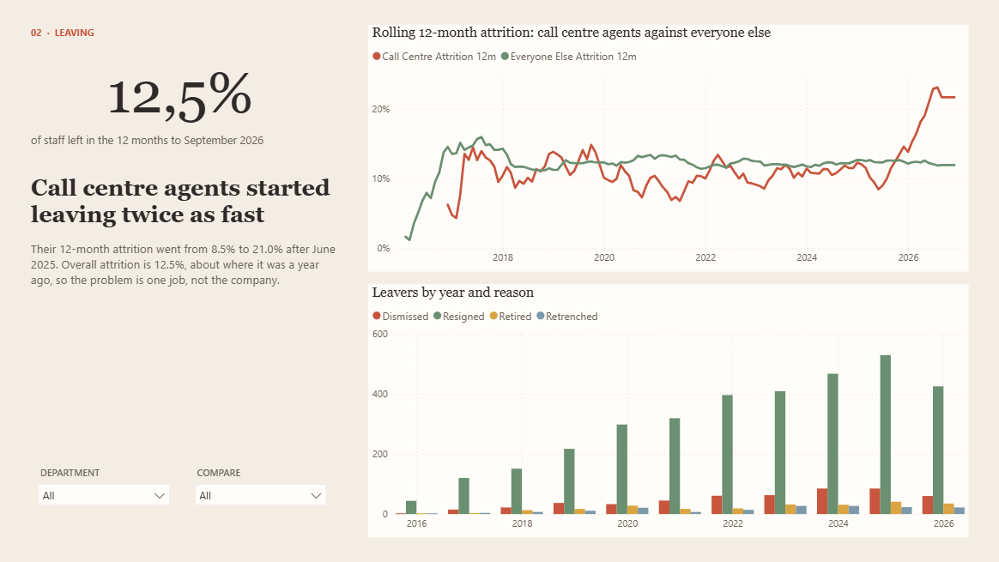
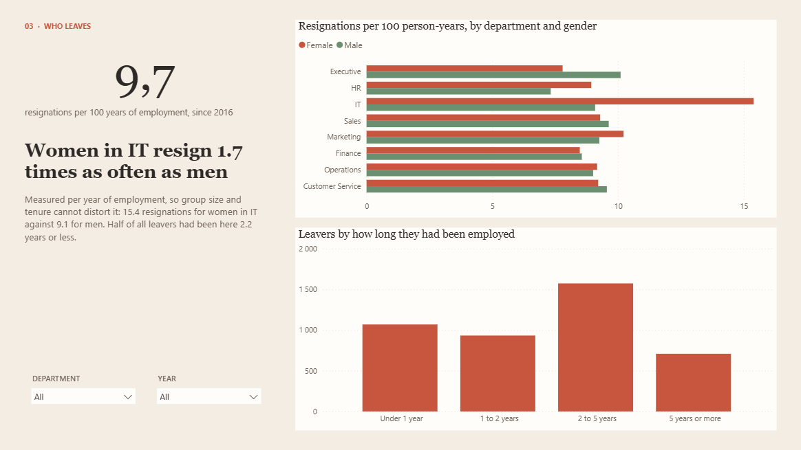
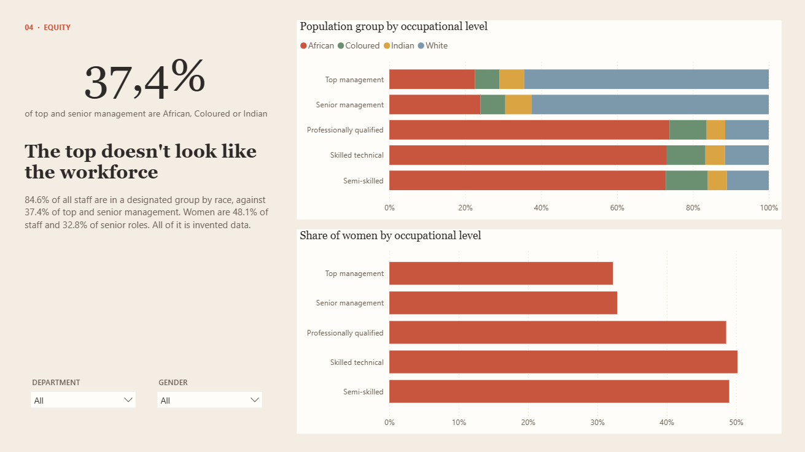
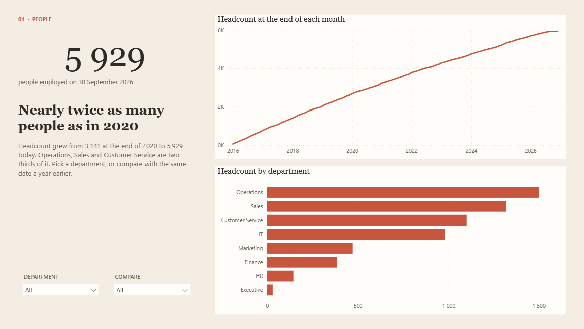

# HR Analytics in Power BI

**An invented South African workforce of 10,214 people, modelled the way an HR team needs it: headcount on any date, attrition that rolls, resignations measured fairly across groups, and the employment-equity picture by occupational level. A manager sees only their own department.**

It is the third Power BI project here, after [Power BI Turnaround](https://github.com/nurah-kamal/business-intelligence/tree/main/power-bi-turnaround) (operations, synthetic) and [CPI Inflation](https://github.com/nurah-kamal/business-intelligence/tree/main/power-bi-cpi) (economics, public data).



## What it shows

Four pages laid out like a magazine spread: one number and the story on the left, the evidence on the right.

| Page | The question it answers |
| --- | --- |
| **01 People** | How many people work here, how fast has that grown, and where? |
| **02 Leaving** | How many leave, and is any one group driving it? |
| **03 Who leaves** | Who resigns more often once group size and time employed are taken out? |
| **04 Equity** | Does management look like the workforce? |

The findings, on the invented data: headcount grew from **3,141** at the end of 2020 to **5,929** on 30 September 2026. Overall 12-month attrition is **12.5%**, about where it was a year earlier, but call centre agents went from **8.5%** to **21.0%** after June 2025. Women in IT resign **15.4** times per 100 years of employment against **9.1** for men. Designated groups by race are **84.6%** of staff but **37.4%** of top and senior management; women are **48.1%** of staff and **32.8%** of senior roles. All three patterns were planted in the generator so the report can be checked against them.

## The part worth copying

- **Headcount on any date, not a stored count.** There is no monthly snapshot table. `Headcount` counts the people hired by the last day in view and not yet gone, so any date, month or year works from one table.
- **Two dates, one date table.** Employees link to the date table on the day they were hired (active) and the day they left (inactive). `Leavers` switches to the leaving date with `USERELATIONSHIP`, so the same year filter answers "hired in 2025" and "left in 2025".
- **Fair comparisons.** `Resignations per 100 Person-Years` divides resignations by the time people actually spent employed in the period, so a small team or a new team can't look better or worse just because of its size or tenure.
- **A calculation group.** `Compare` switches every measure on the page between this period, the same period last year and the change, without a "last year" copy of each measure.
- **Row-level security.** The `Department manager` role filters the Department table to the row whose manager address matches the signed-in user; employees follow through the relationship.
- **Checked, not assumed.** `data/expected.json` holds the figures worked out in plain code from the same data. The measures were checked against them by DAX query, including the calculation group (2025 hires 1,168 against 1,074 a year earlier) and the security role (an unknown user sees nothing; the IT manager's filter gives IT's 980 people).



## The measures

All on the Employees table, in display folders.

| Measure | What it means |
| --- | --- |
| **1 Headcount** | |
| Headcount | People employed on the last day of the period: hired by then and not yet left |
| Headcount at Start | People employed the day before the period starts |
| Average Headcount | The average of headcount at the start and end of the period |
| Average Tenure (Years) | Average years of service of the people employed at the end of the period |
| Median Salary | Middle annual salary of the people employed at the end of the period |
| **2 Movement** | |
| Hires | People who started in the period |
| Leavers | People who left in the period, for any reason (`USERELATIONSHIP` on the leaving date) |
| Resignations | People who chose to leave in the period |
| Net Change | Hires minus leavers |
| **3 Attrition** | |
| Attrition Rate | Leavers in the period over average headcount |
| Attrition 12m | Attrition over the 12 months to the end of the period |
| Resignation Rate 12m | Resignations over the 12 months to the end of the period, over average headcount |
| Call Centre Attrition 12m | Rolling 12-month attrition for call centre agents |
| Everyone Else Attrition 12m | Rolling 12-month attrition for everyone else |
| Person-Years | Total time people spent employed in the period, in years |
| Resignations per 100 Person-Years | Resignations for every 100 years of employment in the period |
| **4 Equity** | |
| Female Share | Share of headcount who are women |
| Designated Share | Share of headcount who are African, Coloured or Indian |
| Designated Share (Top and Senior) | The same, at top and senior management |
| Designated Share (Workforce) | The same, across the whole workforce whatever level is selected |
| Representation Gap (pts) | Points between designated representation at the top and in the workforce |
| Disability Share | Share of headcount with a disability |
| **0 Settings** (hidden) | |
| Data As Of | The last day the data covers: 30 September 2026 |
| Period End | The last day in view, no later than the data, and blank for months after it |

The `Compare` calculation group has three items: **This period**, **Last year** (`SAMEPERIODLASTYEAR`) and **Change**.



## How it is built

| | |
| --- | --- |
| **The data** | `scripts/make_data.py` writes `employees.csv`, `department.csv`, `job.csv`, a daily `calendar.csv` and `expected.json` from a fixed seed. Departments, job titles, provinces, education and salary ranges follow the [HR data generator](https://github.com/nurah-kamal/data-analysis/tree/main/hr-data-generator); leaving dates and reasons, EE occupational levels, population group and disability are added here. There are no names: people are IDs only. |
| **The model** | Import mode. Employees in the middle; Date (marked as the date table, 2016 to 2026), Department and Job around it. Job carries the Employment Equity occupational level. Power Query loads each CSV from one `DataFolder` parameter. |
| **The report** | Four pages in the PBIR format, one JSON file per visual. Sand page, terracotta and sage, serif headings; the theme is in `theme/` and embedded in the report. |
| **The project** | Saved as a `.pbip`, so the model is TMDL text, including the calculation group and the security role. No data is stored in the project. |
| **The tests** | Six Python tests: the CSVs match the script, every date and ID makes sense, there are no names, and each of the three planted patterns is still there. |

## Try it on your own machine

You need Power BI Desktop (Windows, free) for the report, and Python 3.12 for the data and tests.

1. Open `HR Analytics.pbip` in Power BI Desktop.
2. **Home → Transform data → Edit parameters**, and set `DataFolder` to the full path of the `data` folder, ending in a backslash.
3. Click **Apply changes**. If Power BI says a calculation group needs refreshing, click **Refresh now**.
4. To see row-level security: **Modeling → View as**, tick **Department manager** and **Other user**, and enter `it.manager@example.com`. Only IT remains.

To remake the data and run the tests:

```bash
python -m venv .venv
.venv/Scripts/python -m pip install -r requirements.txt
.venv/Scripts/python scripts/make_data.py
.venv/Scripts/python -m unittest discover -s tests
```

## Things worth knowing

**Everything is invented.** Every person, proportion and pattern was made up by the generator. None of it describes a real organisation or real South African labour statistics.

**Designated groups are wider than race.** Under the Employment Equity Act, women and people with disabilities are designated groups too. The race-based share is one measure; the report shows women and disability separately.

**Attrition uses average headcount.** Leavers are divided by the average of headcount at the start and end of the period. Small groups swing a lot from one year to the next, which is why page 3 uses resignations per person-year instead.

**The data stops on 30 September 2026.** Months after that show nothing rather than repeating the last figure.



## Folders

```
HR Analytics.pbip            open this in Power BI Desktop
HR Analytics.SemanticModel/  the model as TMDL: tables, measures, the calculation group, the security role
HR Analytics.Report/         the four report pages, one JSON file per visual
data/                        the CSVs the model loads, and expected.json
scripts/make_data.py         writes the CSVs from a fixed seed
tests/                       the data tests
theme/                       the report theme
docs/img/                    screenshots for this README
```

## Licence

MIT.
