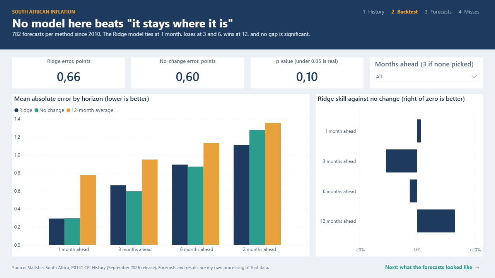
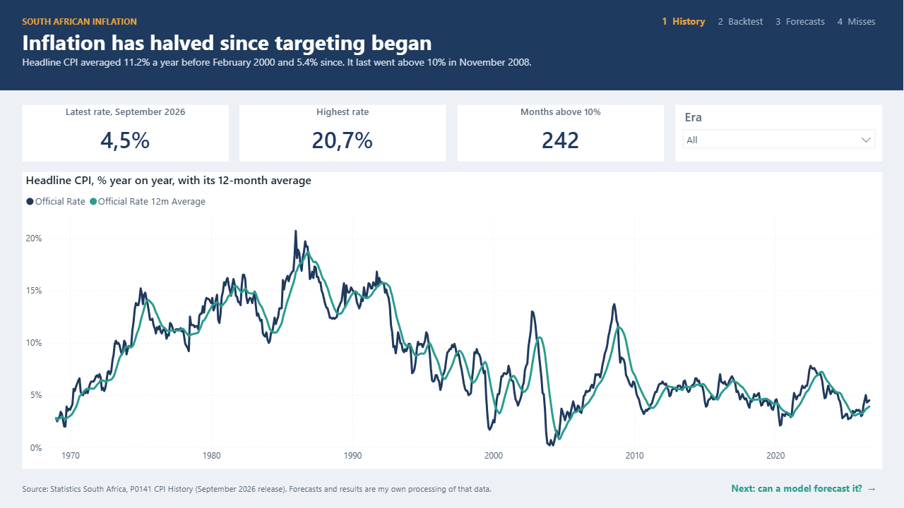
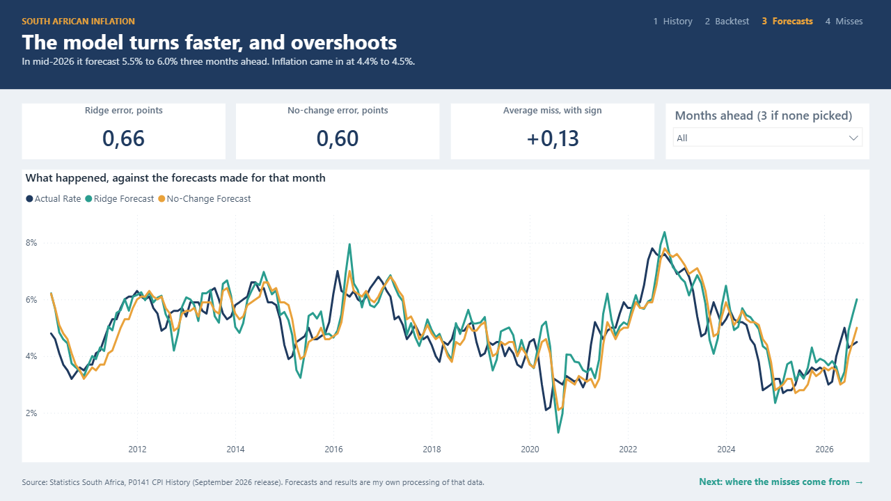
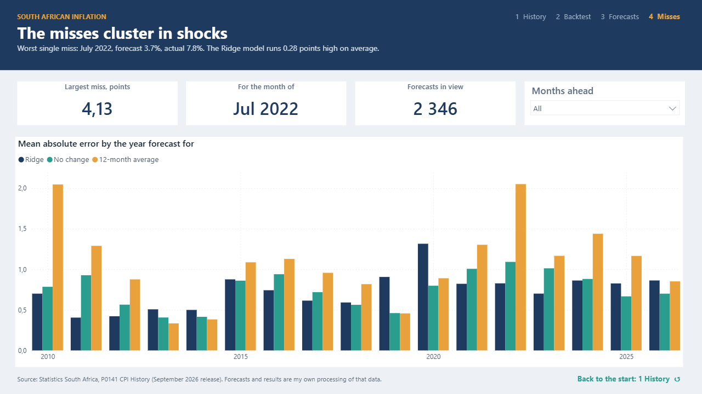

# CPI Inflation in Power BI

[](https://github.com/nurah-kamal/business-intelligence/actions/workflows/power-bi-cpi.yml) 4 tests

**Fifty-seven years of South African inflation from Stats SA, and an honest test of whether a model can forecast it. It can't beat "it stays where it is", and this report shows exactly where and why.**

The backtest comes from [statistical-modelling/cpi-inflation-forecast](https://github.com/nurah-kamal/statistical-modelling/tree/main/cpi-inflation-forecast), rerun here with the same code so every forecast can be explored in Power BI. Its sibling, [Power BI Turnaround](https://github.com/nurah-kamal/business-intelligence/tree/main/power-bi-turnaround), is built on synthetic data; this one is built on official public data.



## What it shows

Four pages that read as one story, each with a header that states the finding, one row of evidence, the chart that proves it, and a pointer to the next page.

| Page | The question it answers |
| --- | --- |
| **1 History** | How has inflation moved since 1969, and what changed when inflation targeting began in February 2000? |
| **2 Backtest** | Does a model forecast inflation better than assuming it stays where it is, 1, 3, 6 and 12 months ahead? |
| **3 Forecasts** | What did the forecasts look like against what happened, at the horizon you pick? |
| **4 Misses** | When do the forecasts go most wrong? |

The findings: headline CPI averaged **11.2%** a year before inflation targeting and **5.4%** since, with a peak of **20.7%** in January 1986. Over 782 forecasts per method from 2010, the Ridge model's mean absolute error is **0.29, 0.66, 0.89 and 1.11** points at 1, 3, 6 and 12 months, against **0.30, 0.60, 0.87 and 1.28** for no change. None of the differences is significant (p from 0.10 to 0.80). The worst single miss was the 12-month average's forecast for July 2022: **3.7%** against **7.8%**.

## The part worth copying

- **Every forecast is a row.** The model holds all 2,346 forecasts, not a summary table, so every error, skill score and chart is a measure over the same rows and they can't disagree.
- **Skill against doing nothing.** `Skill vs No Change` compares any method with the forecast that takes no model at all. A model that can't beat it isn't worth running, and the report says so.
- **Two dates, one date table.** Forecasts link to the date table on the month they were *for* (active) and the month they were *made* (inactive, switched on with `USERELATIONSHIP`).
- **One slicer drives the whole page.** The forecast lines, the error tiles and the p value all follow the horizon slicer, and fall back to 3 months when nothing is picked.
- **Checked against the source project.** The data script reruns the published backtest; a test fails if any error drifts from the published table, and the measures were checked against the same figures by DAX query.
- **Official data, credited.** Stats SA's terms allow reuse with acknowledgement; the source is on every page and in this README.



## The measures

| Measure | What it means |
| --- | --- |
| **1 Inflation** (CPI table) | |
| Official Rate | Stats SA's official year-on-year rate; over several months, their average |
| Rate from Index | Year-on-year inflation worked out from the index: this month's over 12 months earlier |
| Index Check Gap (pts) | Rate from the index minus the official rate; small, because the published index is rounded |
| Official Rate 12m Average | Average official rate over the 12 months to the last month in view |
| Peak Rate | Highest official rate in the period |
| Peak Month | The month of that peak |
| Latest Rate | The official rate in the last month of the period |
| Months Above 10% | Months in the period with inflation above 10% |
| **2 Backtest** (Forecasts table) | |
| Forecasts Count | Forecasts whose target month is in the period |
| Forecasts Made in Period | Forecasts made in the period, whatever month they were for (`USERELATIONSHIP` on the origin month) |
| Mean Absolute Error | Average size of the miss, in percentage points |
| Mean Error | Average miss with its sign: above zero means forecasts ran high |
| No-Change MAE | The no-change forecast's error for the same months and horizons, whatever method is selected |
| Skill vs No Change | How much smaller the error is than no change's; below zero is worse than doing nothing |
| Ridge Skill vs No Change | The same, for the Ridge model only |
| Largest Miss | The biggest single miss in the period |
| Largest Miss Month | The month that miss was for |
| P Value (Ridge vs No Change) | Diebold-Mariano test at one horizon: below 0.05 would mean the gap is real |
| Forecast Value | The forecast; over several, their average |
| Actual Value | The official rate the forecasts were for |
| **3 Forecast lines** (Forecasts table) | |
| Horizon Shown | The horizon the lines use: the one picked, or 3 months (hidden) |
| Actual Rate | The official rate in the target month |
| Ridge Forecast | What the Ridge model forecast for that month |
| No-Change Forecast | The rate known when the forecast was made |
| Average Forecast | The 12-month-average forecast |
| Ridge MAE (Shown) | The Ridge model's error at the horizon shown |
| No-Change MAE (Shown) | The no-change forecast's error at the horizon shown |
| P Value (Shown) | The p value at the horizon shown |



## How it is built

| | |
| --- | --- |
| **The data** | `data/cpi_headline.csv` is Stats SA's headline CPI from the P0141 CPI History (September 2026 release), as extracted in the source project. `scripts/make_data.py` reruns the backtest and writes `forecasts.csv` (2,346 rows), `tests.csv`, a monthly `calendar.csv`, the method and horizon lists, and `expected.json`. |
| **The model** | Import mode. Facts: CPI (one row per month) and Forecasts (one row per forecast). Dimensions: Date (monthly, 1969 to 2026), Method and Horizon, plus the p values in Tests. Power Query loads each CSV from one `DataFolder` parameter. |
| **Time measures** | The date table is monthly, so it isn't marked as a date table and the 12-month average and year-on-year from the index are written by hand with `EDATE`, not with built-in time intelligence. |
| **The report** | Four pages in the PBIR format, one JSON file per visual, on a fixed grid (32px margins, 16px gaps). The navy, teal and amber theme is in `theme/` and embedded in the report. |
| **The project** | Saved as a `.pbip`: the model is TMDL text, so the whole report can be read and reviewed in git. No data is stored in the project. |
| **The tests** | Four Python tests: the CSVs match the script, the calendar covers every month once, no forecast saw its own outcome, and the errors match the published backtest. |

## Try it on your own machine

You need Power BI Desktop (Windows, free) for the report, and Python 3.12 for the data and tests.

1. Clone the repository and open `CPI Inflation.pbip` in Power BI Desktop.
2. **Home → Transform data → Edit parameters**, and set `DataFolder` to the full path of the `data` folder, ending in a backslash.
3. Click **Apply changes**. The tables load in a few seconds.

To remake the data and run the tests:

```bash
python -m venv .venv
.venv/Scripts/python -m pip install -r requirements.txt
.venv/Scripts/python scripts/make_data.py
.venv/Scripts/python -m unittest discover -s tests
```

## Things worth knowing

**This is a backtest of a method, not a forecast.** It shows how three simple methods would have done since 2010. It says nothing about where inflation goes next.

**Only past inflation goes in.** Interest rates, the rand, fuel and food prices drive most of what happens next, and none of them is used. That is why "no change" is so hard to beat here.

**The CPI basket was rebuilt in January 2009.** Stats SA linked the old and new index into one series; the 2009 rates compare against the old basket.

**The test period includes the pandemic and the 2022 spike.** A different period could rank the methods differently.

**Source: Statistics South Africa.** The extraction, the forecasts and every result here are my own processing of that data, not Stats SA's.



## Folders

```
CPI Inflation.pbip           open this in Power BI Desktop
CPI Inflation.SemanticModel/ the model as TMDL: tables, measures, relationships
CPI Inflation.Report/        the four report pages, one JSON file per visual
data/                        Stats SA CPI, every backtest forecast, and expected.json
scripts/make_data.py         reruns the backtest and writes the CSVs
tests/                       the data tests
theme/                       the report theme
docs/img/                    screenshots for this README
```

## Licence

MIT for the code and the report. The CPI data belongs to Statistics South Africa and is used under its terms, which require acknowledging Stats SA as the source.
